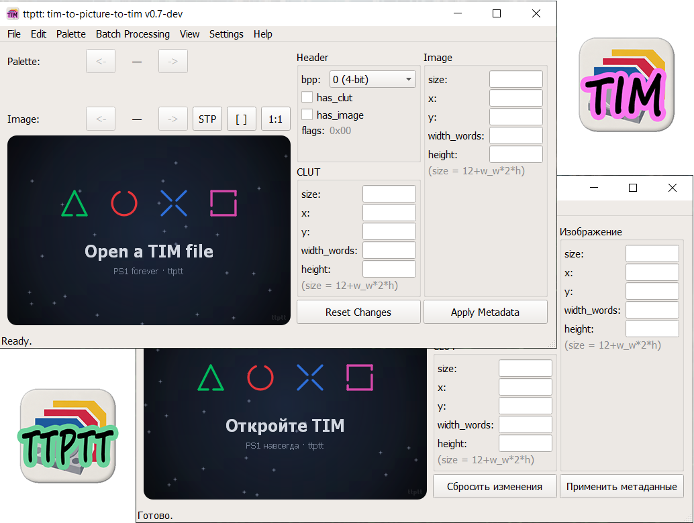

# ttptt — tim-to-picture-to-tim

[English](README.md) | [Русский](README.ru.md)

TIM <-> Image (PNG/BMP) converter for PlayStation 1.

Author: pav13, 2026.

Development: part of the code was prepared with the help of an AI assistant.

GitHub: https://github.com/pav1388/tim-to-picture-to-tim

Forum: https://www.emu-land.net/forum/index.php/topic,93455.0.html

## Screenshots

<p align="center">
  
</p>

## Features

- Support for 4/8/16/24-bit TIM
- Multi-line CLUT, multiple images in a group, multiple groups in a file
- 16bpp <-> 24bpp conversion, splitting/merging images
- Palettes: JASC-PAL / ACT / GIMP GPL / PNG / BMP
- Palette editor: double-click a color
- Current palette index and pixel info in the status bar
- Saving images as PNG and BMP (for 16bpp, STP bits are not saved in BMP — the program warns about this)
- Auto-saving palettes next to the image (separately: manually and in batch)
- Auto-saving `.ttptt` metadata next to the image (separately: manually and in batch)
- "Save all images in every palette": with a multi-line CLUT, each file (including the first and current line) gets a `_palNN` suffix
- Batch operations (extract / replace). Before extraction, a dialog with the parameters of the current run is shown (PNG/BMP format, ACT/PAL/GPL, `.ttptt`, "in all palettes")
- Opening `.ttptt`: images are searched for nearby and re-encoded into TIM. If the file is missing, a placeholder is generated
- Opening "raw" TIM without a signature
- Robust parser (broken headers, padding, truncated files)
- Dark / light themes, recent files list
- Log journal (Settings menu)
- File associations for `.tim` and `.ttptt` — separate (Windows, without administrator rights)
- UI localization: Russian, English

### Drag & Drop

| Extension | Action |
|---|---|
| `.png` / `.bmp` | replace the current image |
| `.pal` / `.act` / `.gpl` | import palette |
| `.ttptt` | open the metadata project |
| other | open as TIM (or "raw" TIM) |

### `.ttptt` metadata

The `.ttptt` file is JSON (UTF-8) and stores **only** what cannot be recovered
from the image:

- group flags and bpp, `has_clut` / `has_image`
- CLUT header and data (base64)
- image block headers (`size`, `x`, `y`, `widthWords`, `height`)
- arbitrary **prefix** before the first TIM (the `prefix` field of the first group)
- **tails** after the blocks — padding, game data (the `extra` field)
- parser warnings

Pixels are not duplicated — the source of truth is the image file (PNG/BMP).
If the images are saved as PNG next to the `.ttptt`, the cycle
`TIM -> PNG + .ttptt -> TIM` restores the file byte-for-byte.

### Searching for images when opening `.ttptt`

In the directory of the `.ttptt`, the following files are searched for:

- For 4/8bpp with a multi-line CLUT — first the file of the **current** palette
  (NN — 1-based CLUT line number, as in the UI):
  - `<name>_palNN.png` / `.bmp`
  - `<name>_imgNN_palNN.png` / `.bmp` (NN — global image block number)
- Then — the base name (for a single palette or as a fallback):
  - `<name>.png` / `.bmp` (if the project has one image)
  - `<name>_imgNN.png` / `.bmp`

The found files are decoded in the current palette and re-encoded
into image data. If the file is missing, a placeholder of the required size is inserted.

### File associations

"Settings" menu:

- `Associate .tim with the program` — `.tim` opens in ttptt
- `Associate .ttptt with the program` — `.ttptt` opens in ttptt
- `Remove .tim` / `.ttptt` association

<details>
<summary><sub>TIM format</sub></summary>

### [1] Global header (8 bytes)

| Offset | Size | Field |
|---|---|---|
| 0–3 | 4 | magic = `0x10 0x00 0x00 0x00` |
| 4–7 | 4 | flags (uint32, little-endian) |

`flags` bits:

- `0–2` — bpp (0 = 4-bit, 1 = 8-bit, 2 = 16-bit, 3 = 24-bit)
- `3` — `has_clut`
- `4` — `has_image`
- `5–31` — reserved (usually 0)

### [2] CLUT block (if `has_clut = 1`)

Header (12 bytes):

| Field | Size | Value |
|---|---|---|
| size | 4 | `12 + data_size` |
| x, y | 2+2 | coordinates in VRAM |
| width_words | 2 | width in 16-bit words |
| height | 2 | number of lines (each — a separate palette) |

Data: `width_words * height * 2` bytes, BGR555 + STP (bit 15).

### [3] Image blocks (if `has_image = 1`)

Header (12 bytes) — the same fields as for CLUT, but `width_words` is
the width in words, not in pixels.

Data by bpp:

| bpp | Pixels per byte | Width in pixels | Format |
|---|---|---|---|
| 4-bit | 2 (lower nibble first) | `width_words * 4` | CLUT indices (up to 16 colors) |
| 8-bit | 1 | `width_words * 2` | CLUT indices (up to 256 colors) |
| 16-bit | 2 bytes per pixel | `width_words` | BGR555 + STP |
| 24-bit | 3 bytes per pixel | `(width_words * 2) / 3` | RGB |

### [4] Prefix and tails

Before the first TIM header there may be an arbitrary prefix
(game container header, padding, etc.). It is saved in the metadata
(the `prefix` field of the first group) and restored during reassembly — the file
undergoes a lossless round-trip.

After all blocks there may be padding, the next TIM (signature
`0x10 0x00 0x00 0x00`), or game data. It is saved in the `extra` field
of the corresponding group.

### PS1 VRAM

1024 × 512 pixels (in 16-bit words). The `x, y` coordinates indicate
where to load the data in VRAM. The CLUT is usually placed in the lower part of VRAM
(`y ≥ 480`).

</details>

## Building

**C++11 + Qt 5.6.3** (Core, Gui, Widgets), static Qt build,
MinGW 4.9.2 32-bit, CMake ≥ 3.5.

### Scripts (Windows)

```
scripts\build.bat         incremental build -> ttptt.exe
scripts\clean-build.bat   delete build\ and rebuild
scripts\release.bat       build releases\tim-to-picture-to-tim-v<ver>\
```

All scripts use the local `qt-5.6.3-static\` folder in the repository
root (not included in git).

### Manually

```bat
cmake -S . -B build -G "MinGW Makefiles" ^
      -DCMAKE_PREFIX_PATH=qt-5.6.3-static ^
      -DTTPTT_QT_DIR=qt-5.6.3-static ^
      -DCMAKE_BUILD_TYPE=Release
cmake --build build -j4
```

### Building Qt

Notes on building the static Qt 5.6.3 used for the release are
in `scripts/BUILD-QT.md`.

## Repository structure

```
CMakeLists.txt          build
version.txt             version (used in APP_VERSION and release.bat)
src/                    sources (C++/Qt)
src/resources/          .qrc and .rc (icons)
scripts/                bat build and release scripts
scripts/BUILD-QT.md     how to build the static Qt 5.6.3 used
sample-tim/             test TIM files
```

## License

GPL-3.0-or-later. See [LICENSE](LICENSE).

The license was chosen because the binary is statically linked with Qt built
under GPL (`-opensource`).