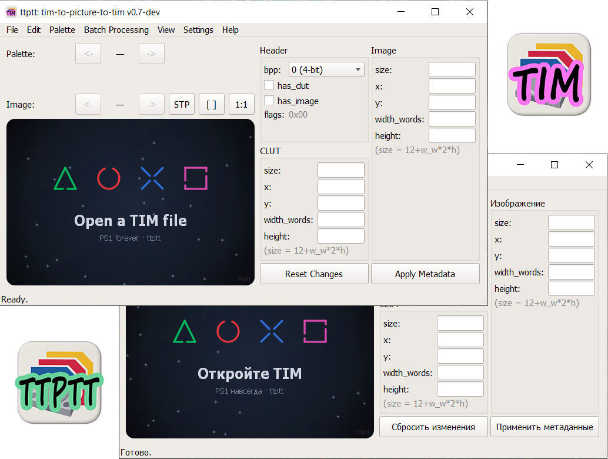

# ttptt — tim-to-picture-to-tim

Конвертер TIM <-> Изображение (PNG/BMP) для PlayStation 1.

Автор: pav13, 2026.

Разработка: часть кода подготовлена с помощью ИИ-ассистента (DeepSeek).

## Скриншоты

<p align="center">
  
</p>

## Возможности

- Поддержка 4/8/16/24-битных TIM
- Многострочные CLUT, несколько изображений в группе, несколько групп в файле
- Конвертация 16bpp <-> 24bpp, разделение/слияние изображений
- Палитры: JASC-PAL / ACT / GIMP GPL / PNG / BMP
- Редактор палитры: двойной клик по цвету
- Индекс текущей палитры и информация о пикселе в строке состояния
- Сохранение изображений в PNG и BMP (для 16bpp STP-биты в BMP не сохраняются — программа предупреждает)
- Автосохранение палитр рядом с изображением (раздельно: вручную и в пакете)
- Автосохранение метаданных `.ttptt` рядом с изображением (раздельно: вручную и в пакете)
- «Сохранять все изображения в каждой палитре»: при многострочном CLUT каждому файлу (включая первую и текущую строку) добавляется суффикс `_palNN`
- Пакетные операции (извлечение / замена). Перед извлечением показывается диалог параметров текущего запуска (формат PNG/BMP, ACT/PAL/GPL, `.ttptt`, «во всех палитрах»)
- Открытие `.ttptt`: изображения ищутся рядом и заново кодируются в TIM. Если файла нет — генерируется заглушка
- Открытие «сырых» TIM без сигнатуры
- Устойчивый парсер (битые заголовки, отступы, обрезанные файлы)
- Тёмная / светлая темы, список недавних файлов
- Журнал логов (меню Настройки)
- Ассоциации файлов `.tim` и `.ttptt` — раздельные (Windows, без прав администратора)
- Локализация интерфейса: русский, английский

### Drag & Drop

| Расширение | Действие |
|---|---|
| `.png` / `.bmp` | замена текущего изображения |
| `.pal` / `.act` / `.gpl` | импорт палитры |
| `.ttptt` | открытие проекта метаданных |
| прочее | открытие как TIM (или «сырой» TIM) |

### Метаданные `.ttptt`

Файл `.ttptt` — JSON (UTF-8), хранит **только** то, что нельзя восстановить
из изображения:

- флаги и bpp группы, `has_clut` / `has_image`
- заголовок и данные CLUT (base64)
- заголовки image-блоков (`size`, `x`, `y`, `widthWords`, `height`)
- произвольный **префикс** перед первым TIM (поле `prefix` первой группы)
- **хвосты** после блоков — паддинг, данные игры (поле `extra`)
- warnings парсера

Пиксели не дублируются — источник истины файл изображения (PNG/BMP).
Если изображения сохранены в PNG рядом с `.ttptt`, цикл
`TIM -> PNG + .ttptt -> TIM` восстанавливает файл байт-в-байт.

### Поиск изображений при открытии `.ttptt`

В каталоге `.ttptt` ищутся файлы:

- Для 4/8bpp с многострочным CLUT — сначала файл **текущей** палитры
  (NN — 1-based номер строки CLUT, как в интерфейсе):
  - `<имя>_palNN.png` / `.bmp`
  - `<имя>_imgNN_palNN.png` / `.bmp` (NN — глобальный номер image-блока)
- Затем — базовое имя (для одной палитры или как fallback):
  - `<имя>.png` / `.bmp` (если в проекте одно изображение)
  - `<имя>_imgNN.png` / `.bmp`

Найденные файлы декодируются в текущей палитре и заново кодируются
в image-данные. Если файла нет — вставляется заглушка нужного размера.

### Ассоциации файлов

Меню «Настройки»:

- `Ассоциация .tim с программой` — `.tim` открывается в ttptt
- `Ассоциация .ttptt с программой` — `.ttptt` открывается в ttptt
- `Снять ассоциацию .tim` / `.ttptt`

<details>
<summary><sub>Формат TIM</sub></summary>

### [1] Глобальный заголовок (8 байт)

| Смещение | Размер | Поле |
|---|---|---|
| 0–3 | 4 | magic = `0x10 0x00 0x00 0x00` |
| 4–7 | 4 | flags (uint32, little-endian) |

Биты `flags`:

- `0–2` — bpp (0 = 4-bit, 1 = 8-bit, 2 = 16-bit, 3 = 24-bit)
- `3` — `has_clut`
- `4` — `has_image`
- `5–31` — зарезервированы (обычно 0)

### [2] CLUT-блок (если `has_clut = 1`)

Заголовок (12 байт):

| Поле | Размер | Значение |
|---|---|---|
| size | 4 | `12 + размер_данных` |
| x, y | 2+2 | координаты в VRAM |
| width_words | 2 | ширина в 16-битных словах |
| height | 2 | число строк (каждая — отдельная палитра) |

Данные: `width_words * height * 2` байт, BGR555 + STP (бит 15).

### [3] Image-блоки (если `has_image = 1`)

Заголовок (12 байт) — те же поля, что у CLUT, но `width_words` — это
ширина в словах, а не в пикселях.

Данные по bpp:

| bpp | Пикселей в байте | Ширина в пикселях | Формат |
|---|---|---|---|
| 4-bit | 2 (младший ниббл первый) | `width_words * 4` | индексы в CLUT (до 16 цветов) |
| 8-bit | 1 | `width_words * 2` | индексы в CLUT (до 256 цветов) |
| 16-bit | 2 байта на пиксель | `width_words` | BGR555 + STP |
| 24-bit | 3 байта на пиксель | `(width_words * 2) / 3` | RGB |

### [4] Префикс и хвосты

Перед первым заголовком TIM может находиться произвольный префикс
(заголовок контейнера игры, паддинг и т.п.). Он сохраняется в метаданных
(поле `prefix` первой группы) и восстанавливается при пересборке — файл
проходит round-trip без потерь.

После всех блоков могут следовать паддинг, следующий TIM (сигнатура
`0x10 0x00 0x00 0x00`) или данные игры. Сохраняется в поле `extra`
соответствующей группы.

### VRAM PS1

1024 × 512 пикселей (в 16-битных словах). Координаты `x, y` указывают,
куда загружать данные в VRAM. CLUT обычно размещают в нижней части VRAM
(`y ≥ 480`).

</details>

## Сборка

Используется **C++11 + Qt 5.6.3** (Core, Gui, Widgets), статическая сборка Qt,
MinGW 4.9.2 32-bit, CMake ≥ 3.5.

### Скрипты (Windows)

```
scripts\build.bat         инкрементальная сборка -> ttptt.exe
scripts\clean-build.bat   удалить build\ и пересобрать
scripts\release.bat       собрать releases\tim-to-picture-to-tim-v<ver>\
```

Все скрипты используют локальную папку `qt-5.6.3-static\` в корне
репозитория (в git не входит).

### Вручную

```bat
cmake -S . -B build -G "MinGW Makefiles" ^
      -DCMAKE_PREFIX_PATH=qt-5.6.3-static ^
      -DTTPTT_QT_DIR=qt-5.6.3-static ^
      -DCMAKE_BUILD_TYPE=Release
cmake --build build -j4
```

### Сборка Qt

Заметки по сборке статической Qt 5.6.3, использованной для релиза, —
в `scripts/BUILD-QT.md`.

## Структура репозитория

```
CMakeLists.txt          сборка
version.txt             версия (используется в APP_VERSION и release.bat)
src/                    исходники (C++/Qt)
src/resources/          .qrc и .rc (иконки)
scripts/                bat-скрипты сборки и релиза
scripts/BUILD-QT.md     как собрать используемую статическую Qt 5.6.3
sample-tim/             тестовые TIM файлы
```

## Лицензия

GPL-3.0-or-later. См. [LICENSE](LICENSE).

Лицензия выбрана потому, что бинарник статически линкуется с Qt, собранной
под GPL (`-opensource`).